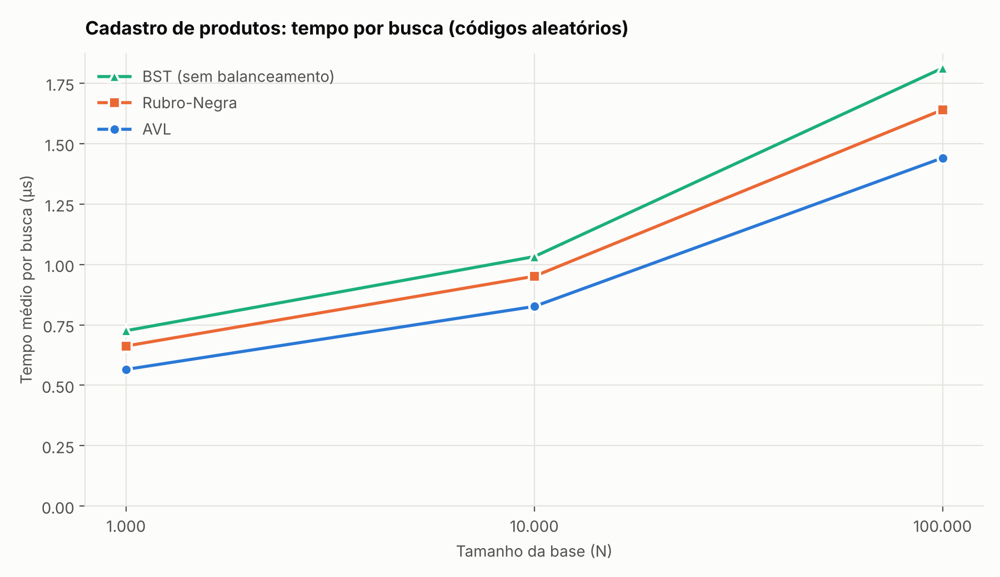
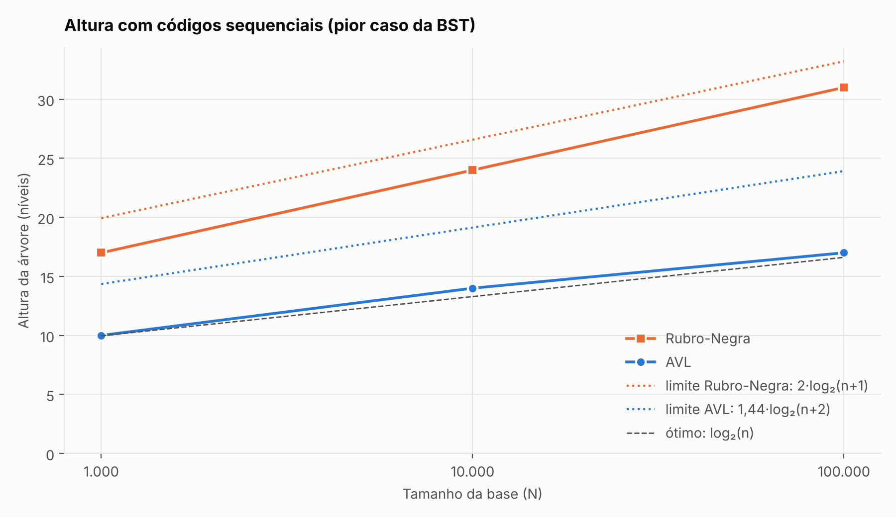
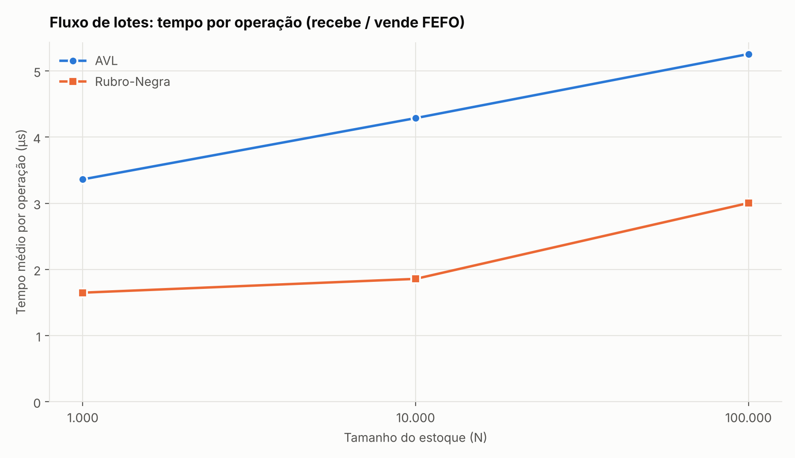
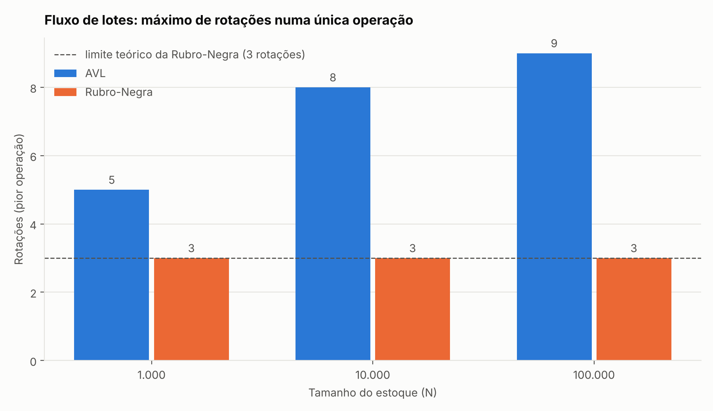
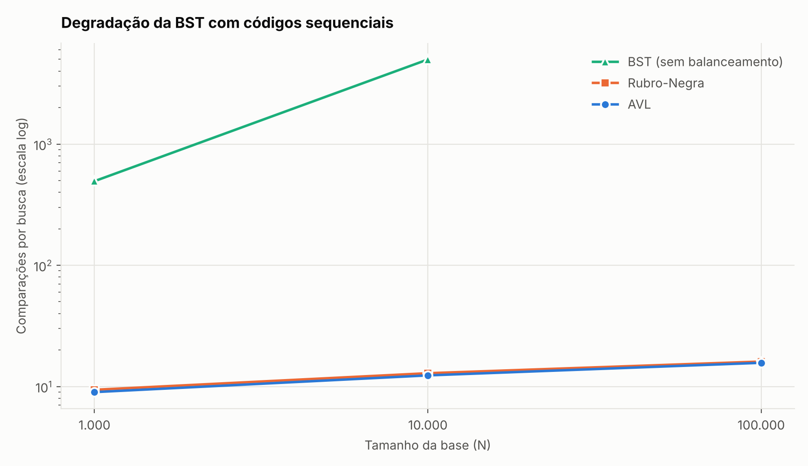

# G02_Arvores_EDA2-2026.2 — Estoque com controle de validade (FEFO)

**Disciplina:** Estruturas de Dados 2 (EDA2) — 2026.2
**Professor:** Maurício Serrano
**Trabalho:** T3 — Árvores de Busca
**Dupla:** João Pedro Araújo de Freitas Lyra (232003661) e Rivadalvio Joaquim da Silva Filho (232024026)

**Vídeo de apresentação:** [youtu.be/ID_DO_VIDEO](https://www.youtube.com/watch?v=ID_DO_VIDEO)

[](https://www.youtube.com/watch?v=ID_DO_VIDEO)

---

## 1. Problema

Toda farmácia vende produtos que vencem. Cada produto chega em **lotes**,
e cada lote tem a sua data de validade. Medicamento vencido não pode ser
vendido: precisa ser descartado e vira prejuízo. A regra do setor para
reduzir essa perda é a **FEFO** (*First Expired, First Out*): na venda
sai sempre o lote que vence primeiro.

Um cadastro que só localiza o produto pelo código não resolve isso. O
sistema precisa responder rápido a cinco perguntas:

| Pergunta | Quando aparece |
|---|---|
| "Qual é o produto com código X?" | a cada venda, recebimento ou consulta de preço |
| "De qual lote eu tiro esta venda?" | a cada venda: o lote válido que vence primeiro |
| "O que vence nos próximos 30 dias?" | promoção ou devolução ao fornecedor |
| "Quais lotes já venceram?" | descarte |
| "Retire o lote L000123 do produto X" | recall (recolhimento após alerta sanitário) |

As perguntas têm **cargas opostas**. O cadastro de produtos é consultado o
tempo todo e quase nunca muda. Os lotes mudam o tempo todo: entram a cada
recebimento e saem a cada venda, descarte ou recall.

## 2. Objetivo e contribuição

Construir do zero duas árvores balanceadas e colocar cada uma no ponto do
sistema em que o seu tipo de balanceamento rende mais. A contribuição é:

1. Separar o sistema pelas **duas cargas** que ele recebe (leitura no
   cadastro, escrita nos lotes) e escolher a árvore pela carga, não por
   preferência;
2. Implementar a **AVL** e a **Rubro-Negra** com a mesma interface, para
   que a comparação entre elas seja justa;
3. **Provar que as árvores estão corretas** antes de medir tempo: testes
   comparam cada árvore com uma referência de força bruta e conferem as
   propriedades de balanceamento depois de milhares de operações
   aleatórias;
4. **Provar a escolha com experimento**: rodar as duas árvores (e a BST
   sem balanceamento, como linha de base) nas duas cargas e mostrar que
   cada uma vence onde foi colocada.

## 3. O que o software faz

O `main.py` tem um menu interativo e uma demonstração roteirizada
(`--demo`). As operações:

| Operação | Estrutura usada | Custo |
|---|---|---|
| Cadastrar / buscar / listar produtos | AVL (código → produto) | O(log n) / O(log n) / O(n) |
| Receber lote | Rubro-Negra do produto + Rubro-Negra global | O(log n + log m) |
| Vender (FEFO) | Rubro-Negra do produto, em ordem de validade, pulando vencidos | O(log m + k) |
| Lotes vencendo em X dias | Rubro-Negra global, consulta por intervalo | O(log m + k) |
| Descartar vencidos | Rubro-Negra global, remoção repetida do mínimo | O(k log m) |
| Recall de um lote | Rubro-Negra do produto | O(log n + m_p) |

Onde `n` é o número de produtos, `m` o número de lotes, `k` o tamanho da
resposta e `m_p` o número de lotes de um produto.

## 4. Núcleo técnico

As estruturas se ligam assim:

```text
produtos (AVL)              código -> Produto
   └── Produto.lotes (Rubro-Negra)    lotes DESTE produto por (validade, lote)  -> venda FEFO
vencimentos (Rubro-Negra)    lotes de TODOS os produtos por (validade, lote)  -> relatórios e descarte
```

Cada lote fica em duas rubro-negras: a do produto e a global. Toda entrada
ou saída de lote atualiza as duas. A chave dos lotes é a tupla
`(validade, número do lote)`: o número desempata lotes que vencem no mesmo
dia, e a ordem da tupla já é a ordem FEFO.

### 4.1 Árvore AVL — cadastro de produtos

*(Rivadalvio)*

A AVL é uma árvore binária de busca em que, para **todo** nó, a diferença
de altura entre as subárvores esquerda e direita (o fator de
balanceamento) é −1, 0 ou +1. Disso sai altura ≤ ~1,44 log₂(n + 2): é a
mais baixa entre as árvores balanceadas do módulo, então a busca faz o
menor número de comparações.

Cada nó guarda a própria altura. Depois de inserir ou remover, a recursão
volta pelo caminho recalculando alturas e corrigindo o primeiro nó que
chegou a fator ±2, com um dos quatro casos:

| Caso | Situação | Correção |
|---|---|---|
| esquerda-esquerda | fator +2, filho esquerdo com fator ≥ 0 | rotação à direita |
| direita-direita | fator −2, filho direito com fator ≤ 0 | rotação à esquerda |
| esquerda-direita | fator +2, filho esquerdo com fator < 0 | rotação à esquerda no filho, depois à direita |
| direita-esquerda | fator −2, filho direito com fator > 0 | rotação à direita no filho, depois à esquerda |

Na inserção, uma correção basta. Na remoção, não: a correção de um nó pode
encurtar a subárvore e desbalancear o pai, então pode haver uma rotação por
nível, ou seja, **O(log n) rotações**. Esse é o preço do balanceamento
rígido, e é por isso que a AVL ficou no cadastro, onde quase não há
remoções.

### 4.2 Árvore Rubro-Negra — lotes por validade

*(João Pedro)*

A rubro-negra pinta cada nó de vermelho ou preto e mantém quatro regras:

1. a raiz é preta;
2. as folhas nulas (NIL) são pretas;
3. um nó vermelho nunca tem filho vermelho;
4. todo caminho de um nó até as folhas tem o mesmo número de nós pretos
   (a altura negra).

Disso sai altura ≤ 2 log₂(n + 1): mais "frouxa" que a AVL, mas o
conserto é barato. Uma inserção faz **no máximo 2 rotações** e uma remoção
**no máximo 3**; o resto é recolorir. Por isso ela é a escolha clássica
para estruturas que mudam o tempo todo (o `TreeMap` do Java, o `std::map`
do C++ e o escalonador CFS do Linux usam rubro-negras).

A implementação segue o Cormen (cap. 13) e usa um **nó sentinela**: um
único nó preto representa todas as folhas NIL. Isso elimina os testes de
`None` nos consertos, porque o sentinela sempre tem cor.

- **Inserção:** o nó entra vermelho. Só a regra 3 pode quebrar. Tio
  vermelho → recolore e sobe o problema; tio preto em "joelho" → uma
  rotação vira o caso em "linha"; em "linha" → recolore e gira o avô.
- **Remoção:** se o nó removido era preto, a regra 4 quebra e o filho que
  sobe carrega um "preto extra". Os quatro casos (irmão vermelho; irmão
  preto com filhos pretos; sobrinho próximo vermelho; sobrinho distante
  vermelho) empurram esse preto para cima ou o eliminam.

A ordem por validade dá as consultas do negócio sem estrutura extra:

- `minimo()` / `remover_minimo()`: o lote que vence primeiro (venda FEFO e
  descarte);
- `intervalo(a, b)`: percorre em ordem só as subárvores que podem ter
  chaves em [a, b], em O(log n + k).

### 4.3 Por que não um heap

Um min-heap entregaria o lote que vence primeiro em O(1). Mas o sistema
precisa de mais do que o mínimo:

| Operação | Heap | Árvore balanceada |
|---|---|---|
| lote que vence primeiro | O(1) | O(log n) |
| "o que vence até a data X", em ordem | O(n log n) | O(log n + k) |
| recall de um lote qualquer | O(n) para achar | O(log n) |
| listar o estoque em ordem de validade | O(n log n) | O(n) |

## 5. Experimento

Bases de 1.000, 10.000 e 100.000 registros, gerados com semente fixa.
Tempos em microssegundos; nas buscas, vale o menor de 5 repetições.
**Comparações, alturas e rotações são contagens exatas**: não dependem da
máquina, da linguagem nem do ruído do sistema operacional.

### 5.1 Corretude

Antes de medir tempo, os testes (`python -m unittest`, 24 testes)
comparam cada árvore com uma referência de força bruta (`dict` + `sorted`)
em 5.000 operações aleatórias de inserir, remover e remover o mínimo, e
conferem as propriedades a cada 250 operações: fator de balanceamento e
alturas na AVL; as quatro regras e os ponteiros de pai na rubro-negra. Os
testes do estoque conferem as regras do negócio: a venda pula lote
vencido, consome em ordem de validade e não altera nada se faltar estoque.

### 5.2 Cenário 1 — cadastro de produtos (carga de leitura)

A árvore é montada com N códigos e depois recebe 10.000 buscas de códigos
existentes.

**Códigos aleatórios:**

| N | BST | AVL | Rubro-Negra | comparações por busca (BST / AVL / RN) |
|---|---|---|---|---|
| 1.000 | 0,73 µs | **0,57 µs** | 0,66 µs | 12,2 / 9,2 / 9,3 |
| 10.000 | 1,03 µs | **0,83 µs** | 0,95 µs | 16,4 / 12,6 / 12,6 |
| 100.000 | 1,81 µs | **1,44 µs** | 1,64 µs | 20,6 / 16,0 / 16,0 |

**Códigos sequenciais** (cadastro em massa vindo do fornecedor, o pior
caso da BST):

| N | BST | AVL | Rubro-Negra | altura (BST / AVL / RN) |
|---|---|---|---|---|
| 1.000 | 26,46 µs | **0,56 µs** | 0,68 µs | 1.000 / 10 / 17 |
| 10.000 | 271,43 µs | **0,80 µs** | 0,96 µs | 10.000 / 14 / 24 |
| 100.000 | *inviável (O(n²) para montar)* | 1,57 µs | 1,55 µs | — / 17 / 31 |





### 5.3 Cenário 2 — fluxo de lotes (carga de escrita)

O estoque começa com N lotes e recebe N operações, alternando
**recebimento** (entra um lote que vence depois dos atuais, como acontece
com remessas novas) e **venda FEFO** (sai o lote que vence primeiro).

| N | BST | AVL | Rubro-Negra | máx. rotações numa operação (AVL / RN) |
|---|---|---|---|---|
| 1.000 | 8,73 µs | 3,36 µs | **1,65 µs** | 5 / 3 |
| 10.000 | 89,73 µs | 4,29 µs | **1,86 µs** | 8 / 3 |
| 100.000 | *inviável (O(n²))* | 5,26 µs | **3,00 µs** | 9 / 3 |





### 5.4 Leituras

**Cada árvore venceu na carga em que foi colocada.** No cadastro, a AVL
foi de 12% a 14% mais rápida que a rubro-negra. No fluxo de lotes, a
rubro-negra foi de 1,8 a 2,3 vezes mais rápida que a AVL.

**A vantagem da AVL vem da altura.** Com 100.000 códigos sequenciais, a
AVL ficou com altura 17, praticamente o ótimo (log₂ n ≈ 16,6); a
rubro-negra chegou a 31, ainda dentro do limite de 2 log₂(n + 1) ≈ 33. Na
média, a diferença de comparações é pequena (15,7 contra 16,1), porque a
maioria dos nós está nos níveis de baixo. Por isso o ganho no tempo médio
é modesto, mas aparece em todos os tamanhos.

**A vantagem da rubro-negra está no pior caso, não na média.** Em média,
as duas fazem quase o mesmo número de rotações (~0,75 a 0,84 por
operação). A diferença está no teto: numa única remoção, a AVL chegou a
**9 rotações**, uma por nível do caminho; a rubro-negra nunca passou de
**3**, exatamente o limite teórico. Além disso, a AVL recalcula as alturas
por todo o caminho a cada operação, enquanto a rubro-negra quase sempre
se resolve com poucas recolorações perto do ponto alterado (~4 por
operação).

**A BST degenera no fluxo real mesmo partindo de dados aleatórios.** Como
os lotes novos vencem depois de todos os existentes, eles se acumulam
sempre à direita e formam uma lista. Com 10.000 lotes, a BST ficou ~48×
mais lenta que a rubro-negra no fluxo e ~340× mais lenta que a AVL na
busca com códigos sequenciais.



**Limitação assumida:** a nossa AVL é recursiva e a rubro-negra é
iterativa. Em Python, a recursão tem custo próprio, então parte da
diferença de tempo no cenário 2 vem da implementação. As contagens de
rotações e as alturas, que não dependem disso, sustentam a mesma
conclusão.

## 6. Análise de complexidade

| Estrutura | Busca | Inserção | Remoção | Altura máxima | Rotações por operação |
|---|---|---|---|---|---|
| BST sem balanceamento | O(log n) médio, O(n) pior | O(log n) médio, O(n) pior | O(log n) médio, O(n) pior | n | 0 |
| AVL | O(log n) | O(log n) | O(log n) | ~1,44 log₂(n + 2) | inserção ≤ 2; remoção O(log n) |
| Rubro-Negra | O(log n) | O(log n) | O(log n) | 2 log₂(n + 1) | inserção ≤ 2; remoção ≤ 3 |

As duas balanceadas têm a mesma complexidade assintótica. A escolha entre
elas está nas constantes: a AVL ganha na busca (árvore mais baixa) e a
rubro-negra ganha na alteração (conserto limitado e mais barato).

## 7. Estrutura do projeto

```
src/
├── avl.py            árvore AVL (cadastro de produtos)
├── rubro_negra.py    árvore rubro-negra (lotes por validade)
├── bst.py            BST sem balanceamento (linha de base do benchmark)
├── models.py         Produto, Lote e geradores de dados
└── estoque.py        sistema FEFO: liga a AVL às rubro-negras

tests/
├── test_avl.py           AVL x força bruta + propriedades
├── test_rubro_negra.py   Rubro-Negra x força bruta + as 4 regras
└── test_estoque.py       regras do negócio (FEFO, vencidos, recall)

main.py               menu interativo e demonstração (--demo)
comparacao.py         benchmark: BST x AVL x Rubro-Negra nas duas cargas
plot_results.py       gera os gráficos a partir do benchmark
assets/               gráficos e JSON da última execução
```

## 8. Como executar

Pré-requisito: Python 3.10+. Só os gráficos precisam de dependência
externa.

```bash
pip install matplotlib

python main.py --demo      # demonstração de todas as operações
python main.py             # menu interativo (opção D carrega uma base de exemplo)

python -m unittest -v      # testes

python comparacao.py       # benchmark (1.000, 10.000 e 100.000), menos de 1 minuto
python comparacao.py 500 5000 50000   # tamanhos personalizados
python plot_results.py     # gera os gráficos em assets/
```

## 9. Bibliografia

- ADELSON-VELSKY, G. M.; LANDIS, E. M. An algorithm for the organization
  of information. *Soviet Mathematics Doklady*, v. 3, p. 1259–1263, 1962.
- CORMEN, T. H. et al. *Introduction to Algorithms*. 3ª ed. MIT Press,
  2009. (capítulo 13: árvores rubro-negras)
- GUIBAS, L. J.; SEDGEWICK, R. A dichromatic framework for balanced trees.
  *19th Annual Symposium on Foundations of Computer Science*, 1978.
- SEDGEWICK, R.; WAYNE, K. *Algorithms*. 4ª ed. Addison-Wesley, 2011.
- ROSA, J. L. G. *SCC-201 — Métodos de Busca*. ICMC/USP, 2009. (material
  base da disciplina)
- ROMERO, R. A. F. *Árvores AVL (Balanceadas)*. SCE-182, ICMC/USP.
- WIKIPEDIA. *Red–black tree*.
